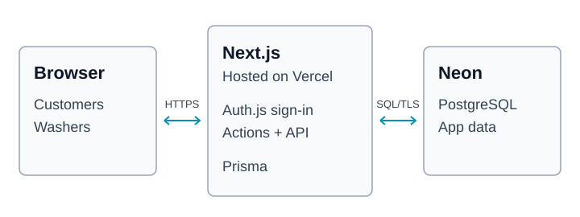

<p align="center">
  
</p>

<h1 align="center">Car wash marketplace</h1>

<p align="center">
  Browse washers, book a time, and manage services.<br />
  <a href="https://sprinkle-mvp.vercel.app">Open the live demo</a>
</p>

Sparkle is a small marketplace MVP with separate customer and washer dashboards. This repository is named **Sprinkle**; the app uses **Sparkle** as its brand.

## What works

| Customers | Washers |
| --- | --- |
| Register and sign in | Register and sign in as a washer |
| Browse washers and their services | Manage services and pricing |
| Create and view bookings | Set weekly availability and view bookings |

**Demo limits:** no real car washes, payments, payouts, or email notifications. Bookings stay `PENDING`. All booking times use **UTC**.

### Try it

Open the [live demo](https://sprinkle-mvp.vercel.app) and sign in with a sample account:

| Role | Email | Password |
| --- | --- | --- |
| Customer | `alice@example.com` | `password123` |
| Washer | `wendy@example.com` | `password123` |

These are public demo accounts. Use sample information when trying the app.

## Architecture



- **Browser:** customer and washer pages, built with React and TypeScript.
- **Vercel:** hosts the Next.js app. Auth.js handles sign-in; server actions and API routes handle bookings, services, and availability.
- **Neon:** stores users, services, availability, and bookings in PostgreSQL. Prisma handles database access; a database constraint prevents overlapping bookings.

The landing page uses Three.js through React Three Fiber. Payments are disabled in the hosted MVP.

## Run locally

### 1. Install and configure

You need **Node.js 22** and a dedicated PostgreSQL database with support for the `btree_gist` extension.

```sh
npm ci
```

Copy `.env.example` to `.env`, then set:

| Variable | Local value |
| --- | --- |
| `DATABASE_URL` | Connection URL for your own demo database |
| `NEXTAUTH_SECRET` | A new random secret |
| `NEXTAUTH_URL` | `http://localhost:3000` |
| `AUTH_TRUST_HOST` | `true` |
| `DEMO_MODE` | `true` |

Generate a secret with Node.js:

```sh
node -e "console.log(require('node:crypto').randomBytes(32).toString('base64'))"
```

Leave Stripe keys blank for the demo.

### 2. Prepare an empty database

```sh
npm run db:generate
npm run db:deploy
npm run db:seed
```

Run the seed **once**, on an empty demo database. It creates the sample accounts, services, availability, and a booking. The seed requires `DEMO_MODE=true` and refuses to run on a populated database.

If your database already contains tables created outside Prisma migrations, inspect and baseline it before applying migrations. Do not reset an existing database to follow these steps.

### 3. Start the app

```sh
npm run dev
```

Open [localhost:3000](http://localhost:3000). The sample accounts listed above also work after local seeding.

## Checks and production build

```sh
npm run typecheck
npm test
npm run build
npm start
```

`npm start` serves the production build. GitHub Actions also checks migrations and database booking constraints against a disposable PostgreSQL database.

## Deploy on Vercel

Use the **Next.js** preset, **Node.js 22**, and build command `npm run build`.

Set the variables from the local configuration table privately in Vercel, using the hosted database URL and the deployment's HTTPS address for `NEXTAUTH_URL`. Generate a separate authentication secret for hosting. Keep `DEMO_MODE=true` and Stripe keys blank.

Apply migrations to the dedicated database, then seed it once if it is empty. Deployment builds generate the Prisma client; they do **not** apply migrations or seed data.

## Credentials

Keep `.env` files and database credentials out of Git. An old `.env` remains in this repository's history; never reuse its database password or authentication secret. Removing a file from the latest commit does not revoke credentials.
